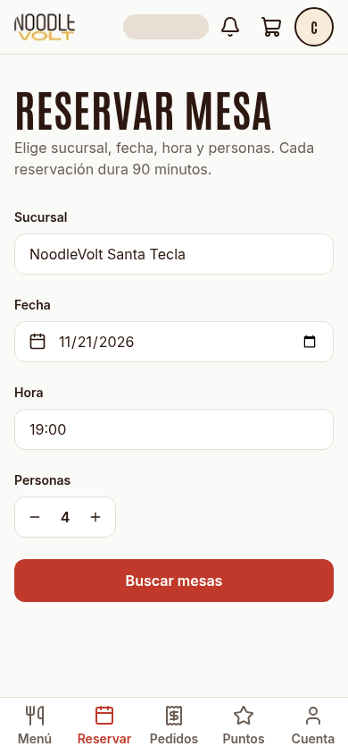
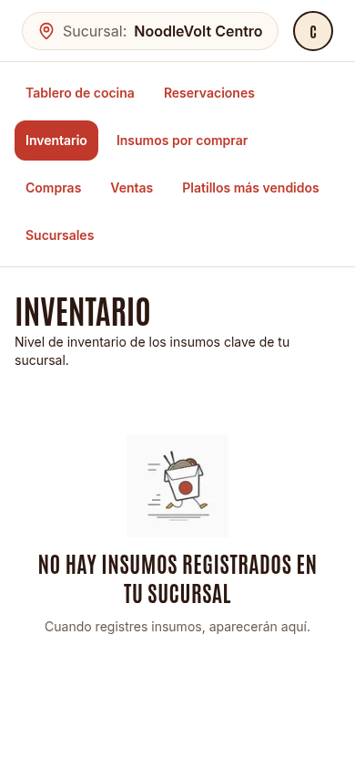

# Guía de uso

Las rutas de esta guía son relativas al dominio del frontend. Inicia sesión con la cuenta de prueba del rol asignado, entregada por Moodle.

| Rol | Entrada | Operaciones |
| --- | --- | --- |
| Cliente (`CLIENT`) | `/menu` | Explorar el menú, pedir para llevar, reservar mesa, simular pago, consultar saldo, notificaciones y dejar reseñas. |
| Mesero (`WAITER`) | `/mesero/listos` | Registrar una comanda y confirmar la entrega de pedidos listos en su sucursal. |
| Cocina (`COOK`) | `/cocina/tablero` | Revisar pedidos y avanzar su preparación hasta Listo. |
| Gerente de sucursal (`BRANCH_ADMIN`) | `/gerente/inventario` | Revisar inventario, compras, reservas, cocina en lectura, reportes y estado de su sucursal. |
| Gerente general (`GENERAL_MANAGER`) | `/gerente/reportes` | Consultar reportes, inventario y sucursales con alcance general. |

`CASHIER` e `INVENTORY_MANAGER` son perfiles heredados sin flujos propios en la interfaz.

## Flujos principales

### Menú, pedido y pago

1. Abre `/menu`, elige una sucursal y agrega platillos.
2. Confirma el pedido en `/pedidos/llevar`. Si aún eres invitado, inicia sesión.
3. Consulta el pedido en `/pedidos` y usa su opción de pago simulado si corresponde.

### Reservas

1. Abre `/reservas`. Si se solicita autenticación, inicia sesión como cliente para volver a la misma pantalla.
2. Selecciona sucursal, fecha, hora y cantidad de personas. Busca una mesa disponible.
3. Selecciona una mesa, completa los datos de contacto y confirma. Si la lista de sucursales está temporalmente indisponible, usa **Reintentar**.
4. El gerente consulta y cancela reservas de su ámbito desde `/gerente/reservaciones`.

Captura de la prueba local con datos simulados.

### Comandas y entrega

1. El mesero elige una mesa y registra la comanda en `/mesero/comanda`.
2. Cocina abre `/cocina/tablero` y avanza el pedido de Pendiente a En preparación y luego a Listo.
3. El mesero abre `/mesero/listos` y confirma la entrega.

### Lealtad, reseñas y notificaciones

1. Consulta el saldo en `/perfil/puntos` y los avisos en `/notificaciones`.
2. En `/pedidos`, abre un pedido entregado y califícalo si aún no tiene reseña.
3. Revisa el promedio por sucursal que aparece en Mis pedidos.

### Inventario, reportes y sucursales

1. El gerente de sucursal consulta inventario y bajo stock en `/gerente/inventario` y `/gerente/insumos-por-comprar`.
2. En `/gerente/compras`, revisa las compras y registra una entrada cuando corresponda.
3. Gerencia consulta ventas y platillos más vendidos en `/gerente/reportes`. En `/admin/sucursales`, el alcance de la operación depende del rol y la sucursal asignada.

Captura de la prueba local con datos simulados.

[Guía de uso del sistema](https://github.com/Aisack23/be_noodlevolt_is_2026/blob/main/docs/01-guia-de-uso.md)
