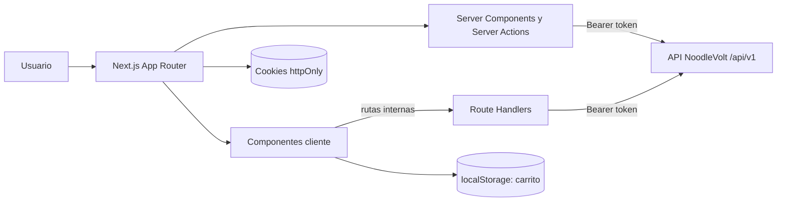

# Arquitectura

## Alcance

Este repositorio contiene únicamente el frontend de NoodleVolt. Consume una API externa configurable; no contiene su backend, base de datos, Docker ni migraciones.

## Vista general



Las llamadas autenticadas se realizan principalmente en componentes del servidor y Server Actions. Las pocas llamadas de cliente que necesitan autenticación pasan por route handlers internos, para mantener la cookie `httpOnly` fuera del navegador.

## Stack

| Capa | Tecnología | Versión declarada |
|---|---|---|
| Framework | Next.js App Router | 16.4.6 |
| UI | React y React DOM | 19.2.8 |
| Lenguaje | TypeScript, modo estricto | 5.x |
| Estilos | Tailwind CSS mediante PostCSS | 4.x |
| Iconos | Lucide React | 1.69.0 |
| Tipografías | Inter y Antonio | 5.3.0 |
| Pruebas | `node:test` y `assert` | Node.js |

## Estructura

```text
app/                 rutas, layouts, Server Actions y route handlers
  api/               puentes internos para notificaciones y lealtad
  gerente/           vistas administrativas
  pedidos/           pedido para llevar, pago y reseñas
  mesero/             comandas y entrega
  cocina/             tablero de cocina
components/
  ui/                componentes visuales reutilizables
  business/          componentes de dominio
lib/
  api/               clientes tipados de la API externa
  auth/              sesión, roles y autenticación
  cart/              contexto y persistencia del carrito
  orders/            tipos y servicio de pedidos simulado legado
tests/               pruebas de contratos y utilidades
docs/                documentación funcional y técnica
public/              recursos estáticos
```

## Decisiones técnicas

| Decisión | Motivo |
|---|---|
| App Router con Server Components y Server Actions | Centraliza las llamadas que requieren token y evita entregarlo al cliente. |
| Cookies `httpOnly` para sesión y actualización | Reduce la exposición del token frente a almacenamiento accesible desde JavaScript. |
| `API_URL` como única base de integración | Permite cambiar el backend sin codificar orígenes ni prefijos en cada módulo. |
| `cache: "no-store"` en datos operativos | Evita mostrar pedidos, inventario, puntos o notificaciones desactualizados. |
| Validación defensiva de DTOs en módulos críticos | Detecta respuestas incompatibles antes de que lleguen a la interfaz. |
| Componentes `ui` y `business` separados | Reutiliza controles visuales sin mezclar sus responsabilidades con cada flujo. |
| Alias `@/*` | Mantiene importaciones estables desde la raíz del proyecto. |

## Rutas internas de API

El frontend expone solo estos puentes internos:

- `GET /api/notifications`
- `PATCH /api/notifications/[id]/read`
- `GET /api/loyalty/me`

No sustituyen al backend: leen la sesión desde la cookie y reenvían la operación a la API externa.
