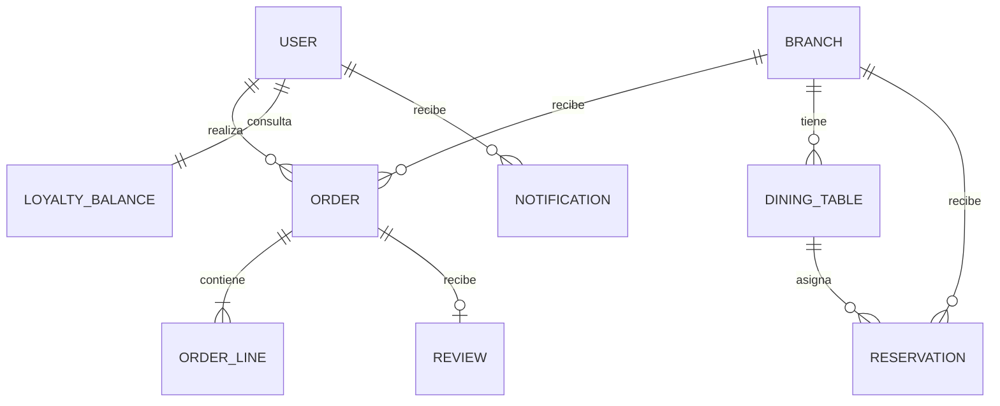

# Modelo de datos de integración

## Alcance

Este frontend no administra una base de datos propia. Este documento describe los modelos de intercambio que consume de la API y el estado local relevante; no es un diagrama físico de tablas del backend.

## Relaciones principales

## Entidades que maneja la interfaz

| Modelo | Campos relevantes | Uso |
|---|---|---|
| Sesión | `id`, `email`, `name`, `role`, `branchId`, vencimiento | Navegación y permisos. |
| Sucursal | `id`, `name`, `address`, `timeZone`, `isActive`, `isOpen` | Menú, administración y filtros. |
| Platillo / menú | identificador, nombre, descripción, precio, disponibilidad, categoría | Catálogo y comandas. |
| Pedido | identificador, número, sucursal, estado, total, modalidad, líneas, retiro | Compra, cocina, entrega y reseña. |
| Línea de pedido | platillo, nombre, precio, cantidad, subtotal, nota según el flujo | Detalle de pedido o comanda. |
| Reservación | sucursal, mesa, inicio/fin, personas, contacto, estado | Reserva del cliente y listado administrativo. |
| Mesa | identificador, número, capacidad, estado, salón | Reserva y comanda de salón. |
| Inventario | insumo, unidad, existencias, mínimo, fecha de actualización | Inventario y compras. |
| Compra | proveedor, factura, fecha y líneas de insumos | Registro y consulta de compras. |
| Reseña | pedido, calificación de 1 a 5, comentario opcional | Pedidos del cliente y promedio de sucursal. |
| Lealtad | `points` entero no negativo | Saldo del cliente. |
| Notificación | tipo, título, mensaje, pedido, lectura y fecha | Campana y buzón. |

## Estados importantes

| Dominio | Estados utilizados por el frontend |
|---|---|
| Pedido | `PENDING_PAYMENT`, `PENDING`, `CONFIRMED`, `IN_PREPARATION`, `READY`, `DELIVERED`, `CANCELED` |
| Pago simulado | `APROBADO`, `RECHAZADO` |
| Reservación | `PENDING`, `CONFIRMED`, `CANCELED`, `COMPLETED`, `NO_SHOW` |
| Mesa de backend | `AVAILABLE`, `OCCUPIED`, `RESERVED`, `OUT_OF_SERVICE`, `NEEDS_CLEANING` |
| Cocina | `PENDING`, `IN_PREPARATION`, `READY` |

## Estado local

El carrito se persiste bajo la clave `noodlevolt_cart` de `localStorage` con platillos y sucursal. El servicio legado de confirmación simulada conserva el último pedido en `noodlevolt_last_order`; el flujo actual de pedido para llevar utiliza la API real. Las cookies de sesión no forman parte de `localStorage` y no son accesibles por JavaScript.
