# NoodleVolt — Hoja de Ruta Frontend y Plan de Implementación
**Documento:** `docs/FRONTEND_ROADMAP.md`  
**Proyecto:** NoodleVolt — Plataforma de gestión de restaurantes multi-sucursal (Equipo Elektro)  
**Versión:** 1.0.0 — Noviembre 2026  
**Fuentes de referencia:** [`AGENTS.md`](file:///c:/Users/diego/OneDrive/Escritorio/fe_noodlevolt_is_2026/AGENTS.md), [`docs/DESIGN_SYSTEM.md`](file:///c:/Users/diego/OneDrive/Escritorio/fe_noodlevolt_is_2026/docs/DESIGN_SYSTEM.md), [`docs/COMPONENTS.md`](file:///c:/Users/diego/OneDrive/Escritorio/fe_noodlevolt_is_2026/docs/COMPONENTS.md), [`docs/figma/ds-state.json`](file:///c:/Users/diego/OneDrive/Escritorio/fe_noodlevolt_is_2026/docs/figma/ds-state.json), [`docs/design-assets/Componentes.png`](file:///c:/Users/diego/OneDrive/Escritorio/fe_noodlevolt_is_2026/docs/design-assets/Componentes.png) y [`CLAUDE.md`](file:///c:/Users/diego/OneDrive/Escritorio/fe_noodlevolt_is_2026/CLAUDE.md).

---

## 1. Resumen Ejecutivo y Diagnóstico de Brechas

Tras la auditoría del código fuente y su cotejo contra el sistema de diseño oficial de Figma y las especificaciones funcionales (HU Final 29/10/2026), se identifican las siguientes conclusiones de arquitectura:

1. **Base atómica sólida:** Se cuenta con componentes fundamentales de excelente calidad técnica y accesibilidad (`Button`, `Input`, `Alerta`, `ChipCategoria`, `EstadoVacio` y `TarjetaPlatillo`).
2. **Brecha de estados en `BadgeEstado`:** El componente actual cubre 14 estados, pero Figma Lote 0 incorporó 11 variantes indispensables para inventario, compras, cuentas y cupones (p. ej. `DESHABILITADO`, `PENDIENTE_PAGO`, `SIN_STOCK`, `ABIERTA`, `CERRADA`).
3. **Brecha en shells y navegación:** La navegación del personal (`Personal/Sidebar`, `Personal/Topbar`, `Personal/Shell`) no existe en el código, impidiendo el despliegue consistente de las vistas de Mesero, Cocina y Gerente. La navegación del cliente (`NavbarCliente`) requiere refactorización para soportar las variantes de usuario con sesión iniciada y selector de sucursal.
4. **Riesgo de duplicación en componentes transversales:** Existen tres subsistemas críticos que se consumen en múltiples historias de usuario:
   - **Plano de Mesas (`Mesa` + `SalonMesas`):** Requerido en Salón (`FE-5.1`), Comandas (`FE-3.1`) y Cuentas de Mesa (`FE-16.1`).
   - **Cobro y Facturación (`PasarelaPago` + `Fiscal/Bloque` + `Comprobante`):** Requerido en Cobro presencial (`FE-16.2`) y Pago en línea (`FE-18.1`).
   - **Estructura Tabular (`Tabla` + `Paginación` + `BarraFiltros`):** Requerido en 8 pantallas administrativas de Gerente y Gerente General.
5. **Alineación de rutas:** Los enlaces en `BottomTabBar` y `FooterCliente` contienen rutas tentativas no canónicas que deben ajustarse a la matriz oficial de rutas.

---

## 2. Matriz de Análisis de Brechas de Componentes

La siguiente matriz clasifica el estado de cada componente, define la acción requerida, mapea sus dependencias directas, asigna prioridad de ejecución y registra el identificador de nodo correspondiente en Figma.

| Componente | Estado actual | Estado requerido | Acción necesaria | Dependencias | Prioridad | Referencia Figma |
|---|---|---|---|---|---|---|
| **Tokens globales y `@theme`** | Implementados parcialmente en `globals.css`. | Soporte para tintes al 12% (`estado/*-tinte`), variables de radio y sombra de foco. | Registrar tokens de tinte hex sólido (#E6EFEA, etc.) y radios en Tailwind v4 para evitar dependencias de opacidad CSS. | Ninguna | **Alta** | Colección `9:4` y `9:19` |
| **`Button`** | Existente y reutilizable (`components/ui/Button.tsx`). | Cumple con variantes `primary`, `secondary`, `danger`, carga y foco. | Mantener sin cambios. Reutilizar en todos los formularios y diálogos. | `lucide-react` | **Baja** | `11:34` |
| **`Input`** | Existente y reutilizable (`components/ui/Input.tsx`). | Cumple con accesibilidad (`aria-describedby`, `aria-invalid`), label y error. | Mantener sin cambios. Integrar en formularios huérfanos (`login-form.tsx`). | `lucide-react` | **Baja** | `11:59` |
| **`BadgeEstado`** | Existente, requiere ajustes (`components/ui/BadgeEstado.tsx`). | Soporte completo para 25 estados de Figma Lote 0 y catálogo. | Incorporar 11 variantes: `DESHABILITADO`, `PENDIENTE_PAGO`, `CANCELADO`, `ABIERTA`, `CERRADA`, `APROBADO`, `RECHAZADO`, `USADO`, `SIN_STOCK`, `BAJO_MINIMO`, `SUFICIENTE`. | `lucide-react` | **Alta** | `11:140` (`40:521`, `96:407` a `96:475`) |
| **`Alerta`** | Existente y reutilizable (`components/ui/Alerta.tsx`). | Bloque de alerta accesible con 4 tonos semánticos. | Mantener sin cambios. Reutilizar en errores de servidor y avisos de pantalla. | `lucide-react` | **Baja** | `27:436` |
| **`ChipCategoria`** | Existente y reutilizable (`components/ui/ChipCategoria.tsx`). | Píldora táctil de selección de categoría. | Mantener sin cambios. Reutilizar en catálogo de menú y filtros rápidos. | Ninguna | **Baja** | `27:395` |
| **`EstadoVacio`** | Existente y reutilizable (`components/ui/EstadoVacio.tsx`). | Ilustración de mascota, Antonio H3, mensaje descriptivo y slot de acción. | Mantener sin cambios. Consumir en todas las listas vacías de la app. | `next/image` | **Baja** | `27:437` |
| **`Skeleton` / `SkeletonFila`** | Existente, requiere ajustes (`components/ui/Skeleton.tsx`). | Marcador de posición para bloques, tarjetas y filas de tabla. | Añadir componente `SkeletonFila` para estados de carga de tablas administrativas. | Ninguna | **Alta** | `40:544`, `40:545`, `40:555` |
| **`TarjetaPlatillo`** | Existente y reutilizable (`components/ui/TarjetaPlatillo.tsx`). | Ficha de platillo para catálogo de cliente. | Reutilizar en FE-2.1. Opcionalmente añadir soporte de click contenedor para FE-11.1 (insumos faltantes). | `BadgeEstado`, `Button`, `next/image` | **Media** | `12:84` |
| **`BottomTabBar`** | Existente, requiere ajustes (`components/ui/BottomTabBar.tsx`). | Navegación móvil con enlaces canónicos de la aplicación. | Corregir rutas: `/reservaciones/disponibilidad`, `/mis-pedidos`, `/mis-puntos` y `/login`. | `lucide-react`, `next/link` | **Media** | `24:486` |
| **`FooterCliente`** | Existente, requiere ajustes (`components/ui/FooterCliente.tsx`). | Pie de página con enlaces oficiales y lista de sucursales. | Ajustar enlaces de sección Explora a rutas oficiales. | `next/link`, `next/image` | **Baja** | `13:306` |
| **`NavbarCliente`** | Existente, requiere refactorización (`components/ui/NavbarCliente.tsx`). | Soporte para Escritorio y Móvil, con sesión (avatar, campana, saldo) e invitado. | Refactorizar para admitir variantes `Sesión=Invitado` vs `Con sesión`, integrar `SelectorSucursal`, `SaldoPuntos`, `Campana` y `Logo/Wordmark` en 360px. | `SelectorSucursal`, `SaldoPuntos`, `Campana`, `Carrito` | **Alta** | `23:328` (`23:227` a `23:311`) |
| **`LoginForm`** | Existente, requiere refactorización (`app/login/login-form.tsx`). | Formulario institucional FE-35.1 con tokens, `Input`, `Button` y `Alerta`. | Reemplazar inputs y botones nativos con `Input`, `Button` y `Alerta` de `components/ui/`. Integrar `Logo/Horizontal`. | `Input`, `Button`, `Alerta` | **Alta** | `132:1208`, `132:1438` |
| **`Select`** | Pendiente de desarrollo. | Desplegable estilizado y accesible con label y error. | Crear `components/ui/Select.tsx` con soporte para options tipadas, focus halo y error. | `lucide-react` | **Alta** | `96:525` |
| **`SelectorFecha`** | Pendiente de desarrollo. | Selector de fecha con popover de calendario y celdas Día. | Crear `components/ui/SelectorFecha.tsx` compatible con formato ISO `AAAA-MM-DD`. | `lucide-react` | **Alta** | `96:956`, `96:751` |
| **`TextareaContador`** | Pendiente de desarrollo. | Área de texto con límite de 200 caracteres y contador visible. | Crear `components/ui/TextareaContador.tsx` con validación de límite y accesibilidad. | Ninguna | **Media** | `96:1086` |
| **`Toggle`** | Pendiente de desarrollo. | Switch accesible para opciones binarias activas/inactivas. | Crear `components/ui/Toggle.tsx` con área táctil $\ge 44\text{ px}$. | Ninguna | **Baja** | `96:1155` |
| **`Estrellas`** | Pendiente de desarrollo. | Calificación 1 a 5 con medias estrellas y visualización numérica. | Crear `components/ui/Estrellas.tsx` para modo interactivo (reserva/pedido) y modo lectura con número. | `lucide-react` | **Media** | `96:1387` |
| **`CantidadStepper`** | Pendiente de desarrollo. | Selector incremental/decremental de 1 a 20 unidades. | Crear `components/ui/CantidadStepper.tsx` con botones `+` y `-` táctiles y deshabilitado en límites. | `lucide-react` | **Alta** | `27:396` |
| **`Paginación`** | Pendiente de desarrollo. | Paginación estándar de 10 registros para Desktop 1440 y Móvil 360. | Crear `components/ui/Paginacion.tsx` con páginas 1 a 5, botones previo/siguiente y adaptación responsive. | `Button`, `lucide-react` | **Alta** | `153:1417` |
| **`ModalConfirmacion`** | Pendiente de desarrollo. | Ventana modal accesible para acciones críticas (pagar, cancelar). | Crear `components/ui/ModalConfirmacion.tsx` con backdrop, títulos y variantes normal o peligro (`danger`). | `Button`, `lucide-react` | **Alta** | `96:1448`, `27:512` |
| **`PanelLateral`** | Pendiente de desarrollo. | Cajón deslizable (drawer) desde la derecha con botón cerrar. | Crear `components/ui/PanelLateral.tsx` con tramado semitransparente para soporte de notificaciones e insumos. | `lucide-react` | **Media** | `96:1473` |
| **`BarraFiltros`** | Pendiente de desarrollo. | Barra contenedora de controles de búsqueda y filtros. | Crear `components/ui/BarraFiltros.tsx` con adaptación flexible para escritorio y tablet. | `Input`, `Select` | **Media** | `96:1542` |
| **`Tabla`** | Pendiente de desarrollo. | Componente contenedor de tablas con `TablaEncabezado` y `TablaCelda`. | Crear `components/ui/Tabla.tsx` respetando tipografía Inter de 14px y scroll horizontal responsivo. | Ninguna | **Alta** | `27:491`, `27:493` |
| **`SelectorSucursal`** | Pendiente de desarrollo. | Dropdown de selección de sucursal con pin de mapa. | Crear `components/ui/SelectorSucursal.tsx` para barra de cliente. | `lucide-react` | **Media** | `12:88` |
| **`ChipSucursal`** | Pendiente de desarrollo. | Píldora indicadora de sucursal para barra móvil 360. | Crear `components/ui/ChipSucursal.tsx`. | Ninguna | **Media** | `23:215` |
| **`SaldoPuntos`** | Pendiente de desarrollo. | Indicador de saldo de puntos de lealtad en barra superior. | Crear `components/ui/SaldoPuntos.tsx` con estados normal, cargando y error. | `lucide-react`, `Skeleton` | **Media** | `12:95` |
| **`Campana`** | Pendiente de desarrollo. | Botón de campana con contador no leído y despliegue de avisos. | Crear `components/ui/Campana.tsx` con polling cada 15 s (S5). | `lucide-react`, `PanelLateral` | **Media** | `12:99` |
| **`Carrito`** | Pendiente de desarrollo. | Acceso al pedido para llevar con contador flotante de ítems. | Crear `components/ui/Carrito.tsx`. | `lucide-react` | **Media** | `12:105` |
| **`Personal/Sidebar`** | Pendiente de desarrollo. | Barra lateral fija marrón (`marca/brown`) para Mesero, Gerente y GG. | Crear `components/layout/PersonalSidebar.tsx` con enlaces según rol autenticado y estado activo. | `next/link`, `lucide-react` | **Alta** | `127:1319` |
| **`Personal/Topbar`** | Pendiente de desarrollo. | Barra superior del personal con sucursal fija, campana y perfil. | Crear `components/layout/PersonalTopbar.tsx`. | `Campana`, `lucide-react` | **Alta** | `13:180` |
| **`Personal/Shell`** | Pendiente de desarrollo. | Layout base para tablet (1024) y desktop (1440) de personal. | Crear `components/layout/PersonalShell.tsx` unificando Sidebar y Topbar. | `PersonalSidebar`, `PersonalTopbar` | **Alta** | `13:202` |
| **`Mesa`** | Pendiente de desarrollo. | Ficha visual de mesa (número, capacidad, estado, selección). | Crear `components/business/Mesa.tsx` con variantes `LIBRE`, `OCUPADA`, `POR_LIMPIAR`. | `BadgeEstado` | **Alta** | `27:478` (`27:445`–`27:471`) |
| **`SalonMesas`** | Pendiente de desarrollo. | Cuadrícula organizada del salón de mesas. | Crear `components/business/SalonMesas.tsx` reutilizable en Mesero y Cuentas. | `Mesa`, `EstadoVacio`, `Skeleton` | **Alta** | `109:4633` |
| **`Salón/Leyenda`** | Pendiente de desarrollo. | Bloque de simbología de estados de mesa. | Crear `components/business/SalonLeyenda.tsx`. | `BadgeEstado` | **Baja** | `109:4503` |
| **`OpcionPago`** | Pendiente de desarrollo. | Selector de modalidad (Pagar en línea vs Pagar en caja). | Crear `components/business/OpcionPago.tsx`. | `lucide-react` | **Media** | `27:490` |
| **`Cocina/EncabezadoPedido`** | Pendiente de desarrollo. | Encabezado de comanda en tablero con tipografía $\ge 24\text{ px}$. | Crear `components/business/CocinaEncabezadoPedido.tsx`. | `BadgeEstado` | **Alta** | `109:4357` |
| **`Cocina/LíneaPedido`** | Pendiente de desarrollo. | Renglón de platillo con notas y botón de cambio de estado. | Crear `components/business/CocinaLineaPedido.tsx`. Texto $\ge 24\text{ px}$. | `Button`, `BadgeEstado` | **Alta** | `109:4471` |
| **`Mesero/FilaListo`** | Pendiente de desarrollo. | Fila de entrega de platillo listo con botón "Entregado". | Crear `components/business/MeseroFilaListo.tsx`. | `Button` | **Media** | `109:4502` |
| **`PanelInsumosFaltantes`** | Pendiente de desarrollo. | Panel de insumos faltantes para 1 porción al tocar platillo agotado. | Crear `components/business/PanelInsumosFaltantes.tsx`. | `PanelLateral`, `Tabla` | **Media** | `109:4732` |
| **`Cuenta/Desglose`** | Pendiente de desarrollo. | Resumen contable de cuenta de mesa: subtotal, propina (10%), total. | Crear `components/business/CuentaDesglose.tsx`. | Ninguna | **Alta** | `122:978` |
| **`Pago/FilaMetodo`** | Pendiente de desarrollo. | Renglón interactivo de cobro mixto (efectivo con vuelto y tarjeta). | Crear `components/business/PagoFilaMetodo.tsx`. | `Input` | **Alta** | `122:1018` |
| **`Pedido/FilaLlevar`** | Pendiente de desarrollo. | Fila de orden para llevar con estado de pago. | Crear `components/business/PedidoFilaLlevar.tsx`. | `BadgeEstado`, `Button` | **Media** | `122:1060` |
| **`Fiscal/Bloque`** | Pendiente de desarrollo. | Formulario de datos fiscales (DUI/NIT, NRC, nombre contribuyente). | Crear `components/business/FiscalBloque.tsx` con validaciones de formato salvadoreño (S12). | `Input`, `Select` | **Alta** | `122:1141` |
| **`PasarelaPago`** | Pendiente de desarrollo. | Formulario de pago simulado (tarjeta 4242 / 0002 con retardo de 2 s). | Crear `components/business/PasarelaPago.tsx` reutilizable en FE-16.2 y FE-18.1. | `Input`, `Button`, `Alerta` | **Alta** | `122:1216` |
| **`Comprobante`** | Pendiente de desarrollo. | Visualización digital e imprimible de ticket/factura fiscal. | Crear `components/business/Comprobante.tsx`. | `next/image` | **Media** | `122:970` |
| **`PlantillaAccesoDenegado`** | Pendiente de desarrollo. | Pantalla de permiso denegado con botón "Volver al inicio". | Crear `components/feedback/AccesoDenegado.tsx`. | `Button`, `lucide-react` | **Alta** | `98:646` |
| **`PlantillaErrorServidor`** | Pendiente de desarrollo. | Bloque de fallo 500 con botón "Reintentar". | Crear `components/feedback/ErrorServidor.tsx`. | `Button`, `Alerta` | **Alta** | `98:673` |

---

## 3. Detección de Duplicidades y Similitudes Funcionales

Para mantener la base de código limpia y evitar componentes redundantes, se establecen los siguientes criterios de unificación:

1. **`ChipCategoria` vs `ChipSucursal`:**
   - *Análisis:* Ambos son contenedores píldora redondeados con bordes. Sin embargo, `ChipCategoria` es un control interactivo de estado binario (`aria-pressed`) con estilo naranja activo, mientras que `ChipSucursal` es un indicador contextual de sucursal en barra móvil.
   - *Decisión:* Mantenerlos separados por claridad de responsabilidad funcional y desacoplamiento de eventos.
2. **Familia de Skeletons (`Skeleton`, `SkeletonTarjeta`, `SkeletonFila`):**
   - *Análisis:* Existía el riesgo de dispersar los esqueletos de carga en archivos por pantalla.
   - *Decisión:* Centralizar todos los marcadores animados en un único módulo [`components/ui/Skeleton.tsx`](file:///c:/Users/diego/OneDrive/Escritorio/fe_noodlevolt_is_2026/components/ui/Skeleton.tsx), exportando `Skeleton`, `SkeletonTarjeta` y el nuevo `SkeletonFila`.
3. **Flujo de Pago y Cobro (`PasarelaPago` y `Fiscal/Bloque`):**
   - *Análisis:* Tanto el mesero al cobrar en mesa con tarjeta (`FE-16.2`) como el cliente al pagar en línea (`FE-18.1`) requieren simular la tarjeta (regla 2 s, tarjeta 4242/0002) y emitir comprobante con datos fiscales (`FE-19.1`).
   - *Decisión:* Desarrollar `PasarelaPago` y `FiscalBloque` como componentes de negocio compartidos en `components/business/` para reutilizarlos en ambos flujos sin duplicar lógica de validación tributaria ni simulación de tarjeta.
4. **Visualización y Selección de Mesas (`Mesa` y `SalonMesas`):**
   - *Análisis:* Tres historias consumen el plano de mesas: Salón (`FE-5.1`), Comandas (`FE-3.1`) y Cuentas (`FE-16.1`).
   - *Decisión:* Desarrollar `SalonMesas` de forma agnóstica con callbacks tipados (`onMesaClick`) para que funcione en modo interactivo (seleccionar mesa para abrir comanda) o modo operativo (marcar mesa como limpia).
5. **Modales de Diálogo:**
   - *Análisis:* Figma define `Modal/Encabezado` (`27:512`) y `Modal/Confirmación` (`96:1448`).
   - *Decisión:* Unificar la lógica en `ModalConfirmacion.tsx`, permitiendo componer el título, mensaje y botón de acción (con variante primaria o de peligro `danger`).

---

## 4. Grafo de Dependencias entre Componentes

El siguiente diagrama ilustra las dependencias arquitectónicas y el orden natural de construcción:

```mermaid
flowchart TD
    subgraph CapaAtomica ["Capa 1: Átomos y Tokens (Independientes)"]
        TOKENS["Tokens CSS / globals.css"]
        BTN["Button.tsx"]
        INP["Input.tsx"]
        BE["BadgeEstado.tsx (ajustado)"]
        ALT["Alerta.tsx"]
        SK["Skeleton.tsx (+ SkeletonFila)"]
        CC["ChipCategoria.tsx"]
        EV["EstadoVacio.tsx"]
    end

    subgraph CapaMoleculas ["Capa 2: Moléculas y Controles Compuestos"]
        SEL["Select.tsx"]
        SF["SelectorFecha.tsx"]
        TX["TextareaContador.tsx"]
        STEP["CantidadStepper.tsx"]
        PAG["Paginación.tsx"]
        MOD["ModalConfirmacion.tsx"]
        PAN["PanelLateral.tsx"]
        TAB["Tabla.tsx (Encabezado/Celda)"]
        EST["Estrellas.tsx"]
    end

    subgraph CapaShell ["Capa 3: Estructura y Navegación"]
        NAV_CLI["NavbarCliente.tsx (refactorizado)"]
        TAB_BAR["BottomTabBar.tsx (ajustado)"]
        SIDE_PER["Personal/Sidebar.tsx"]
        TOP_PER["Personal/Topbar.tsx"]
        SHELL_PER["Personal/Shell.tsx"]
    end

    subgraph CapaNegocio ["Capa 4: Componentes de Dominio"]
        MESA["Mesa.tsx"]
        SALON["SalonMesas.tsx"]
        PASARELA["PasarelaPago.tsx"]
        FISCAL["FiscalBloque.tsx"]
        COCINA_ENC["Cocina/EncabezadoPedido.tsx"]
        COCINA_LIN["Cocina/LíneaPedido.tsx"]
        COMPROBANTE["Comprobante.tsx"]
    end

    subgraph CapaPantallas ["Capa 5: Pantallas Integradas"]
        P_LOGIN["/login y /registro (FE-35.1)"]
        P_MENU["/menu y catálogo (FE-1.1, FE-2.1)"]
        P_MESERO["/mesero/* (FE-3.1, FE-5.1, FE-7.1, FE-16.1, FE-16.2)"]
        P_COCINA["/cocina/tablero (FE-6.1)"]
        P_GERENTE["/gerente/* y /reportes/* (FE-10.1 a FE-34.1)"]
    end

    TOKENS --> BTN & INP & BE & ALT & SK
    BTN & INP --> SEL & SF & TX & STEP & MOD & PASARELA & FISCAL
    BTN & SK --> PAG & TAB
    BE --> MESA & COCINA_LIN & TAB
    MESA --> SALON
    BTN & ALT --> P_LOGIN
    NAV_CLI & TAB_BAR --> P_MENU
    SIDE_PER & TOP_PER --> SHELL_PER
    SHELL_PER --> P_MESERO & P_GERENTE
    SALON --> P_MESERO
    COCINA_ENC & COCINA_LIN --> P_COCINA
    PASARELA & FISCAL & COMPROBANTE --> P_MESERO
    TAB & PAG & MOD --> P_GERENTE
```

---

## 5. Plan de Implementación por Fases

El despliegue técnico del frontend se ejecutará en 5 fases secuenciales, respetando estrictamente las dependencias de diseño y arquitectura.

---

### FASE 1: Sistema de Diseño y Configuración Global

**Objetivo:** Consolidar los cimientos visuales y de tipografía para que todos los componentes consuman clases y tokens idénticos sin sobrescrituras arbitrarias.

- **Tareas técnicas:**
  1. **Ajuste de tokens en [`app/globals.css`](file:///c:/Users/diego/OneDrive/Escritorio/fe_noodlevolt_is_2026/app/globals.css):**
     - Registrar formalmente las variables de tinte de estado al 12% con sus valores hex oficiales de Figma (`--color-success-tinte: #E6EFEA;`, `--color-warning-tinte: #F6EFE4;`, `--color-danger-tinte: #F3E6E6;`, `--color-info-tinte: #E6EDF6;`, `--color-neutral-tinte: #F3F2F1;`).
     - Registrar variables de dimensión táctil `--size-touch: 44px;` y radio de píldora `--radius-pill: 9999px;`.
  2. **Verificación de Fuentes Google:**
     - Comprobar la carga correcta de Antonio (`--font-antonio`) e Inter (`--font-inter`) en [`app/layout.tsx`](file:///c:/Users/diego/OneDrive/Escritorio/fe_noodlevolt_is_2026/app/layout.tsx).
  3. **Ajustes a [`components/ui/BadgeEstado.tsx`](file:///c:/Users/diego/OneDrive/Escritorio/fe_noodlevolt_is_2026/components/ui/BadgeEstado.tsx):**
     - Incorporar las 11 variantes pendientes de Figma Lote 0 (`DESHABILITADO`, `PENDIENTE_PAGO`, `CANCELADO`, `ABIERTA`, `CERRADA`, `APROBADO`, `RECHAZADO`, `USADO`, `SIN_STOCK`, `BAJO_MINIMO`, `SUFICIENTE`).
  4. **Ajustes a [`components/ui/Skeleton.tsx`](file:///c:/Users/diego/OneDrive/Escritorio/fe_noodlevolt_is_2026/components/ui/Skeleton.tsx):**
     - Crear y exportar `SkeletonFila` para habilitar las pantallas de carga de tablas.
- **Criterio de aceptación:** Ejecución limpia de `npm run build` y `npm run lint` sin advertencias de tipos o estilos.

---

### FASE 2: Componentes Básicos Reutilizables

**Objetivo:** Desarrollar los elementos de control y entrada atómicos requeridos para construir formularios complejos y listas paginadas.

- **Tareas técnicas:**
  1. **`components/ui/Select.tsx`:** Selector desplegable con etiqueta, foco halo, soporte de error contextual y estilos deshabilitados.
  2. **`components/ui/SelectorFecha.tsx`:** Campo de fecha con soporte de formato canónico y calendario emergente accesible.
  3. **`components/ui/TextareaContador.tsx`:** Textarea con contador de caracteres (límite 200 según S2) y feedback de límite alcanzado.
  4. **`components/ui/Toggle.tsx`:** Switch táctil accesible de 44px para configuraciones booleanas.
  5. **`components/ui/CantidadStepper.tsx`:** Selector incremental/decremental con límites de 1 a 20 platillos (S1).
  6. **`components/ui/Estrellas.tsx`:** Control de calificación de 1 a 5 estrellas con soporte para medias estrellas y modo numérico en lectura.
  7. **`components/ui/Paginacion.tsx`:** Componente de paginación de 10 registros por página (S21) con variante Desktop 1440 y Móvil 360 centrada.
  8. **Corrección de enlaces en [`components/ui/BottomTabBar.tsx`](file:///c:/Users/diego/OneDrive/Escritorio/fe_noodlevolt_is_2026/components/ui/BottomTabBar.tsx) y [`components/ui/FooterCliente.tsx`](file:///c:/Users/diego/OneDrive/Escritorio/fe_noodlevolt_is_2026/components/ui/FooterCliente.tsx):**
     - Actualizar rutas a `/reservaciones/disponibilidad`, `/mis-pedidos` y `/mis-puntos`.
- **Criterio de aceptación:** Todos los controles básicos cuentan con pruebas de renderizado, soporte táctil $\ge 44\text{ px}$ y contraste visual verificado.

---

### FASE 3: Componentes Compuestos y Shells de Navegación

**Objetivo:** Crear los contenedores de diálogo, tablas estructuradas y la arquitectura de marcos de navegación (Shell) para Cliente y Personal.

- **Tareas técnicas:**
  1. **Diálogos y Cajones:**
     - `components/ui/ModalConfirmacion.tsx`: Diálogo modal accesible con backdrop semitransparente, foco atrapado y variante normal o de peligro.
     - `components/ui/PanelLateral.tsx`: Drawer deslizable para notificaciones e insumos.
  2. **Componentes Tabulares y Filtros:**
     - `components/ui/Tabla.tsx`: Estructura unificada exportando contenedor, encabezados y celdas con scroll horizontal protegido.
     - `components/ui/BarraFiltros.tsx`: Contenedor flexible de búsqueda rápida y selectores.
  3. **Plantillas de Estado:**
     - `components/feedback/AccesoDenegado.tsx`: Pantalla estándar de autorización denegada con botón de regreso.
     - `components/feedback/ErrorServidor.tsx`: Bloque de reintento para errores 500.
  4. **Refactorización de Navegación del Cliente ([`components/ui/NavbarCliente.tsx`](file:///c:/Users/diego/OneDrive/Escritorio/fe_noodlevolt_is_2026/components/ui/NavbarCliente.tsx)):**
     - Implementar variante `Invitado` y `Con sesión`.
     - Integrar `SelectorSucursal`, `ChipSucursal`, `SaldoPuntos` y `Campana`.
     - Utilizar `Logo/Wordmark` en resolución móvil de 360px.
  5. **Navegación del Personal:**
     - `components/layout/PersonalSidebar.tsx`: Barra lateral marrón con opciones por rol (Mesero, Gerente, Gerente General).
     - `components/layout/PersonalTopbar.tsx`: Barra superior con sucursal fija, notificaciones y usuario.
     - `components/layout/PersonalShell.tsx`: Contenedor maestro para Desktop (1440) y Tablet (1024).
- **Criterio de aceptación:** Las plantillas de layout responden adecuadamente a los breakpoints de 360px, 1024px y 1440px sin desbordamiento horizontal.

---

### FASE 4: Componentes Específicos de Negocio

**Objetivo:** Construir los bloques funcionales que concentran las reglas de negocio del restaurante, encapsulándolos para su consumo directo en las páginas.

- **Tareas técnicas:**
  1. **Salón y Mesas:**
     - `components/business/Mesa.tsx`: Tarjeta de mesa con número, capacidad y estados (`LIBRE`, `OCUPADA`, `POR_LIMPIAR`).
     - `components/business/SalonMesas.tsx`: Cuadrícula del plano de mesas para salón, comanda y cobro.
     - `components/business/SalonLeyenda.tsx`: Leyenda de estados.
  2. **Cocina y Comandas:**
     - `components/business/CocinaEncabezadoPedido.tsx`: Cabecera con número de pedido grande ($\ge 24\text{ px}$) y origen.
     - `components/business/CocinaLineaPedido.tsx`: Platillo a $24\text{ px}$ con observaciones y botón de cambio de estado.
     - `components/business/MeseroFilaListo.tsx`: Renglón de platillo listo para entregar con botón "Entregado".
     - `components/business/PanelInsumosFaltantes.tsx`: Detalle de insumos requeridos vs disponibles al seleccionar un platillo agotado.
  3. **Cobro, Caja y Facturación:**
     - `components/business/CuentaDesglose.tsx`: Detalle de consumo, subtotal y cálculo de propina sugerida (10%).
     - `components/business/PagoFilaMetodo.tsx`: Selector de cobro mixto en mesa (efectivo con vuelto automático y tarjeta).
     - `components/business/PedidoFilaLlevar.tsx`: Fila informativa para entrega en mostrador.
     - `components/business/FiscalBloque.tsx`: Captura de datos fiscales con validación de DUI/NIT y NRC (`0000000-0`).
     - `components/business/PasarelaPago.tsx`: Formulario de pago simulado con retardo de 2 segundos, soporte de tarjeta 4242 (aprobada) y 0002 (fondos insuficientes).
     - `components/business/Comprobante.tsx`: Vista digital e imprimible del ticket con Wordmark y correlativo fiscal.
- **Criterio de aceptación:** Todos los componentes de negocio cumplen con las restricciones numéricas (USD 2 decimales, regla 24px cocina, validaciones fiscales).

---

### FASE 5: Integración de Componentes en las Pantallas

**Objetivo:** Conectar los componentes construidos en las rutas y vistas del App Router correspondientes a cada tarea FE.

- **Tareas técnicas:**
  1. **FE-35.1 (`/login` y `/registro`):**
     - Refactorizar [`app/login/login-form.tsx`](file:///c:/Users/diego/OneDrive/Escritorio/fe_noodlevolt_is_2026/app/login/login-form.tsx) consumiendo `Input`, `Button`, `Alerta` y `Logo/Horizontal`.
     - Implementar la pantalla `/registro`.
  2. **FE-1.1 y FE-2.1 (`/gerente/catalogo` y `/menu`):**
     - Integrar `Tabla`, `ModalConfirmacion`, `Select` y `Paginacion` en catálogo del gerente.
     - Conectar `PanelInsumosFaltantes` en `/menu` cuando un rol del personal toque un platillo agotado (FE-11.1).
  3. **FE-3.1, FE-5.1 y FE-7.1 (`/mesero/*`):**
     - Integrar `SalonMesas` en salón y comanda.
     - Integrar `MeseroFilaListo` en `/mesero/listos`.
  4. **FE-6.1 (`/cocina/tablero`):**
     - Ensamblar el tablero horizontal a pantalla completa con `CocinaEncabezadoPedido`, `CocinaLineaPedido` y polling de 5 segundos.
  5. **FE-16.1, FE-16.2, FE-17.1 y FE-18.1 (`/mesero/cuentas`, `/pedidos/*/pago`):**
     - Ensamblar el flujo de cobro dividido en mesa integrando `CuentaDesglose`, `PagoFilaMetodo`, `FiscalBloque`, `PasarelaPago` y `Comprobante`.
     - Conectar el pago en línea del cliente (`FE-18.1`).
  6. **FE-10.1 a FE-34.1 (Reservaciones, Inventario, Compras y Reportes):**
     - Ensamblar las vistas administrativas bajo `PersonalShell` utilizando `BarraFiltros`, `Tabla`, `Paginacion`, `SelectorFecha` y modales.
- **Criterio de aceptación:** Validación de los 6 estados de pantalla en cada vista (vacío, cargando, error servidor, error validación, éxito y sin permiso) y verificación visual contra los frames oficiales de Figma.

---

## 6. Priorización Técnica y Justificación

| Nivel de Prioridad | Bloque de Trabajo | Justificación Técnica |
|---|---|---|
| **P1 — Inmediata** | FASE 1: Tokens globales, ampliación de `BadgeEstado` y `SkeletonFila`. | **Desbloqueo transversal:** Cada pantalla y componente compuesto depende de los estados semánticos del restaurante y de los esqueletos de carga. Ampliar `BadgeEstado` ahora evita que los desarrolladores creen badges ad-hoc o clases de color no estandarizadas. |
| **P2 — Crítica** | FASE 2: Controles básicos (`Select`, `Paginacion`, `ModalConfirmacion`, `TextareaContador`). | **Dependencias de formularios y listas:** No es posible implementar ninguna tabla administrativa (inventario, compras, reservaciones) sin `Paginacion` y `Select`, ni operaciones irreversibles (cancelar, cobrar) sin `ModalConfirmacion`. |
| **P3 — Alta** | FASE 3: `PersonalShell`, `PersonalSidebar` y refactorización de `NavbarCliente`. | **Envolvente arquitectónica:** El personal (Mesero, Cocina, Gerente) no cuenta con estructura de navegación en el proyecto. Tener el Shell listo permite montar las páginas de forma limpia sin reinventar barras de navegación por pantalla. |
| **P4 — Alta** | FASE 4: Componentes transversales (`SalonMesas`, `PasarelaPago`, `FiscalBloque`). | **Eliminación de duplicidad:** Evita codificar la lógica de mesas tres veces (FE-5.1, FE-3.1, FE-16.1) y la simulación de cobro con tarjeta dos veces (FE-16.2 y FE-18.1). |
| **P5 — Media** | FASE 4: Componentes especializados (`Cocina/*`, `Estrellas`, `Comprobante`). | **Funcionalidades de épicas específicas:** Componentes acotados al tablero de cocina, centro de reseñas y comprobantes finales de compra. |
| **P6 — Final** | FASE 5: Integración y pruebas de pantallas completas. | **Fase de ensamblaje:** Se ejecuta sobre componentes ya probados y validados individualmente, garantizando estabilidad funcional y alta fidelidad con Figma. |

---
*Fin del documento de hoja de ruta y análisis de brechas. El archivo ha sido guardado en `docs/FRONTEND_ROADMAP.md`.*
